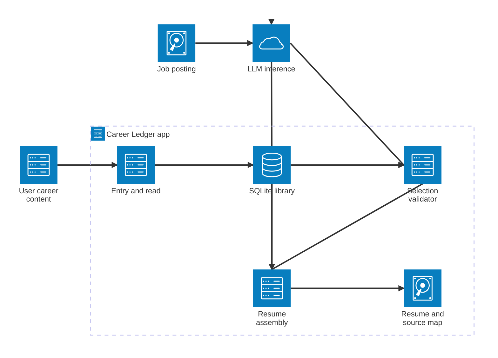
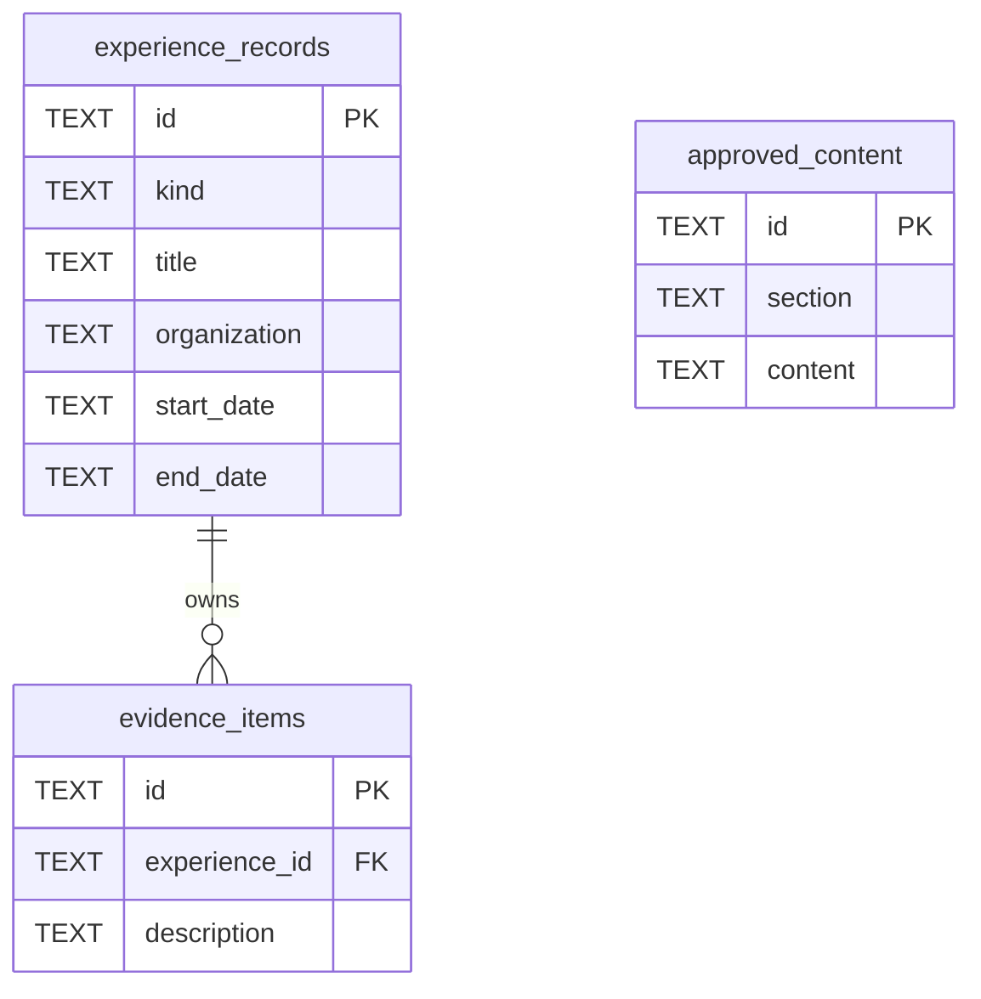

# Career Ledger — diagrams

**Status:** The SQL schema exists and storage CLI exist on `revamp`; model inference, selection validation, and resume assembly are **proposed**, not implemented.

## 1. System architecture



## 2. Resume build — handoffs

```mermaid
swimlane-beta LR
    subgraph user [User]
        job[Supply job posting]
        review[Review resume]
    end
    subgraph app [Application]
        options[Request offered evidence]
        prompt[Compose posting, options and versioned instructions]
        valid{Proposal valid?}
        failure[Return violations]
        fetch[Request selected source content]
        assembly[Assemble approved sections]
    end
    subgraph database [SQLite]
        available[Read evidence IDs, text and parent context]
        chosen[Read selected evidence, parents and approved content]
    end
    subgraph llm [LLM]
        relate[Interpret relational problem space]
        propose[Return evidence IDs and stated relationships]
    end
    subgraph document [Output]
        resume[Resume and source-ID map]
    end

    job --> options --> available --> prompt --> relate --> propose --> valid
    valid -->|Invalid JSON or IDs| failure
    valid -->|Valid| fetch --> chosen --> assembly --> resume --> review
```

**What crosses the model boundary:** `job_description` and `options` (IDs, text, parent context) go in; `matches` (requirement, evidence ID, relationship) and `unmatched_requirements` come out. The problem space is evaluated by the model, **not** serialized or stored as an authoritative object.

## 3. Current SQLite schema



`approved_content` is independent of experience/evidence. `evidence_items.experience_id` is a foreign key; moving an item changes its parent reference, not its ID or text.
