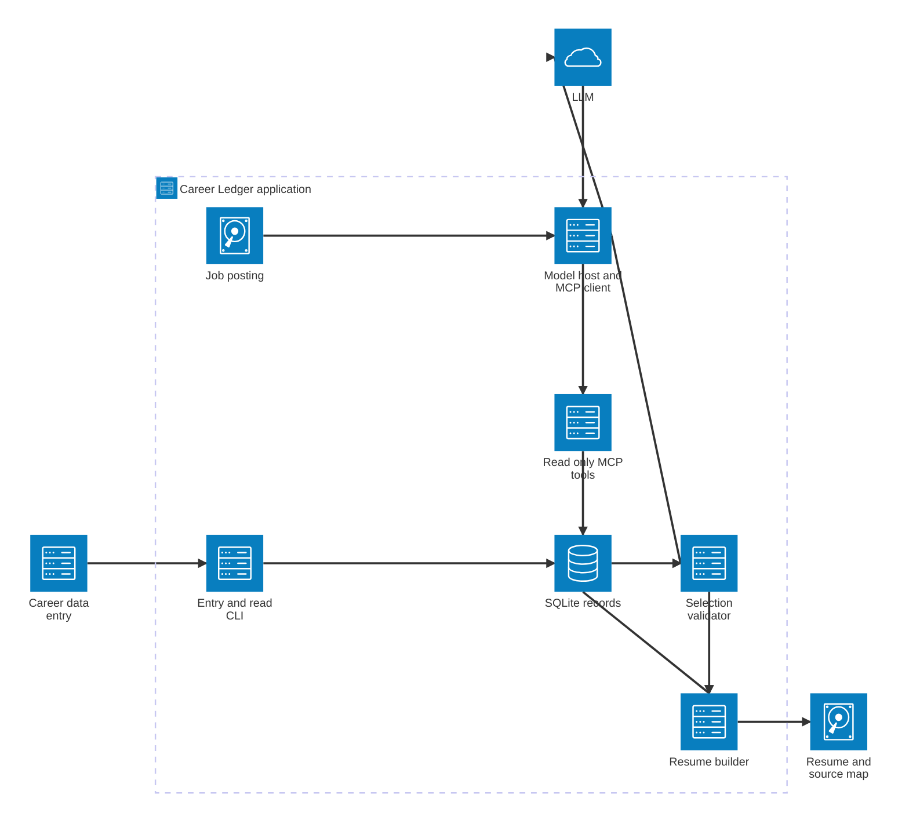
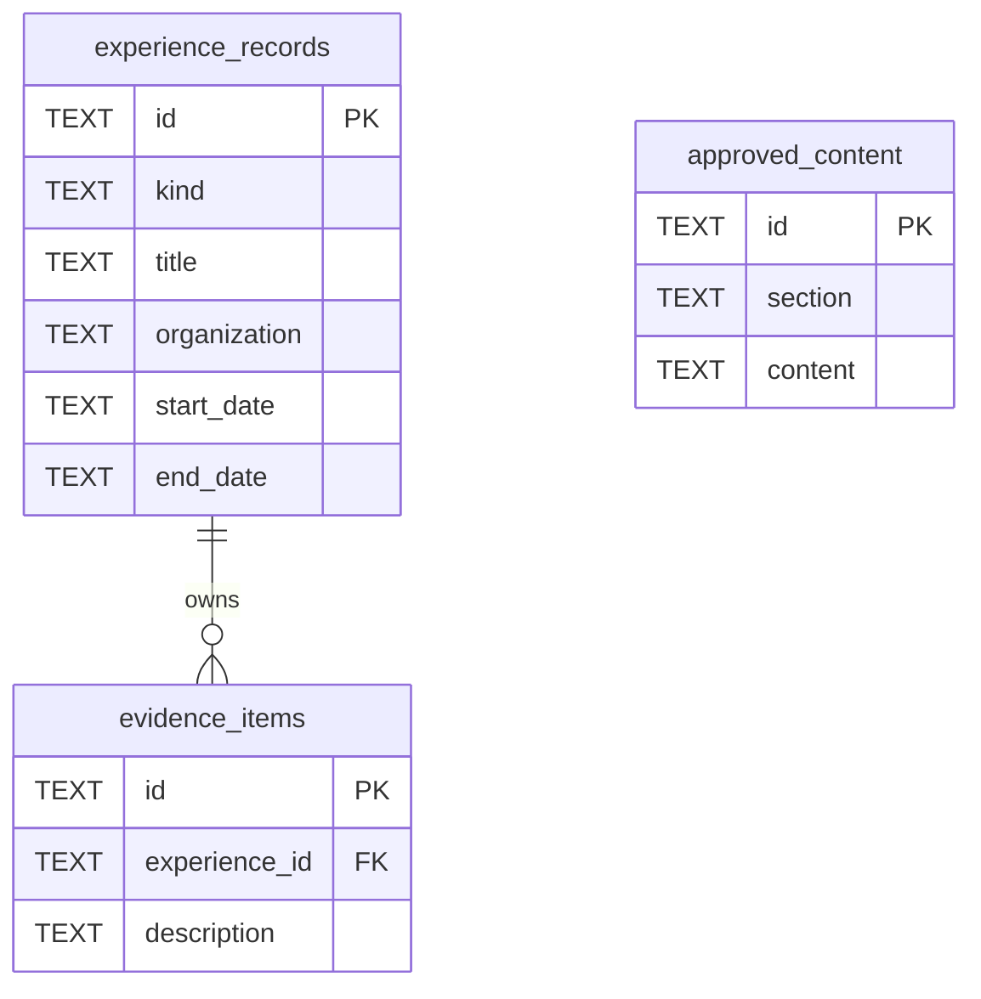

# Career Ledger — diagrams

**Status:** SQLite schema, CLI, and two MCP tools (`list_experiences`, `list_evidence`) are implemented; `get_evidence`, model integration, validation, and resume assembly are proposed.

## 1. System architecture



The MCP server exposes **read-only operations** over the existing SQLite records. The validator and builder are ordinary app code, not MCP tools/resources.

## 2. Resume build — observable handoffs

```mermaid
swimlane-beta LR
    subgraph user [User]
        job[Supply job posting]
        review[Review resume]
    end
    subgraph host [Model host and application]
        prompt[Supply posting and versioned instructions]
        dispatch[Forward requested tool call]
        return[Return tool results and counts]
        valid{Schema and source IDs valid?}
        failure[Return violations]
        fetch[Retrieve chosen source records]
        assembly[Assemble source-grounded sections]
    end
    subgraph llm [LLM]
        explore[Choose discovery or detail request]
        relate[Interpret encountered evidence against posting]
        propose[Propose observed evidence IDs and relationships]
    end
    subgraph mcp [Read only MCP server]
        tools[List experiences, list evidence, get evidence]
    end
    subgraph database [SQLite]
        available[Return bounded records and parent context]
        selected[Return source text and approved content]
    end
    subgraph output [Artifact]
        resume[Resume and source-ID map]
    end

    job --> prompt --> explore --> dispatch --> tools --> available --> return --> relate
    relate -->|Explore further| explore
    relate -->|Propose| propose --> valid
    valid -->|Invalid| failure
    valid -->|Valid| fetch --> selected --> assembly --> resume --> review
```

Each list result reports `items`, `total`, and `has_more`. Records not encountered are **unknown**, not irrelevant. The model may request more records; it cannot run SQL directly. Only the final proposal goes to the validator, which does not judge semantic relevance.

## 3. Current SQLite schema



`approved_content` is independent of experience/evidence. `evidence_items.experience_id` is a foreign key; moving an item changes its parent reference, not its ID or text.
