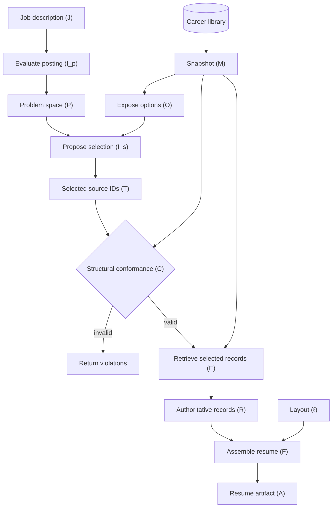

$$
\boxed{\text{Evaluate} \rightarrow \text{Propose} \rightarrow \text{Validate} \rightarrow \text{Execute}}
$$

1. **Problem-space evaluation:** Interpret the job posting—its requirements, priorities, constraints, and relationships. Determine what kind of experience would be relevant.
2. **Proposition from supplied options:** Evaluate the actual career database against that problem space. Propose a selection of existing evidence, rather than inventing new options.
3. **Structural conformance:** Ensure the proposed selections reference valid, authorized database objects.
4. **Deterministic execution:** Retrieve the selected content and assemble it according to the application's output contract.

$$
\begin{aligned}
P &= I_p(J)\\
O &= \operatorname{Options}(M)\\
T &= I_s(P,O)\\
C(T,M) &\in \{\text{valid},\text{invalid}\}\\
R &= E(T,M) \quad \text{if valid}\\
A &= F(R,\ell)
\end{aligned}
$$

| Symbol | Meaning |
| --- | --- |
| $(J)$ | User-supplied job description |
| $(M)$	| Frozen snapshot of the authorized career database |
| $(I_p)$	| LLM inference function that evaluates the job description |
| $(P)$	| **Inferred problem space:** requirements, priorities, and relationships |
| $(\operatorname{Options})$	| Deterministic function exposing selectable database content |
| $(O)$	| Available career evidence and other authorized content |
| $(I_s)$	| LLM inference function proposing relevant options |
| $(T)$	| Proposed selection of source identifiers, optionally with relevance rationales |
| $(C)$	| Deterministic structural conformance validator |
| $(E)$	| Deterministic execution function retrieving selected records |
| $(R)$	| Retrieved authoritative content |
| $(\ell)$ | Resume layout or template configuration |
| $(F)$	| Deterministic resume assembly and formatting function |
| $(A)$ |	Assembled resume artifact |

**Two important distinctions**
**First:** $(I_p)$ and $(I_s)$ are conceptually distinct inference operations. **Separate LLM calls required for each remains undetermined.**

**Second:** $(C)$ checks structural validity, not semantic relevance. A valid selection means the referenced source content exists and satisfies the application's selection rules. It doesn't mean the model made a good relevance judgment.

**The core proposition is now represented explicitly:**
$$
\boxed{T=I_s(I_p(J),\operatorname{Options}(M))}
$$

Interpret the problem, evaluate the available options, and propose a selection. Everything downstream is deterministic under this initial design.

## Data flow (conceptual)

### 1. Populate the library

### 2. Build a resume

## Still to define

- **Database schema:** Persisted career content, stable IDs, and record relationships.
- **Inference interfaces:** Posting/options inputs and problem-space/selection outputs; call boundaries undecided.
- **Assembly contract:** Retrieved-content and layout inputs, resume sections, and output format.
