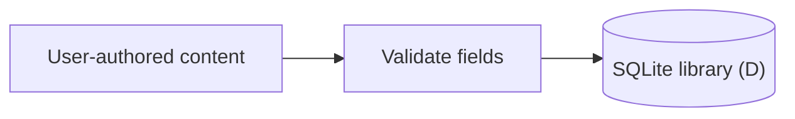
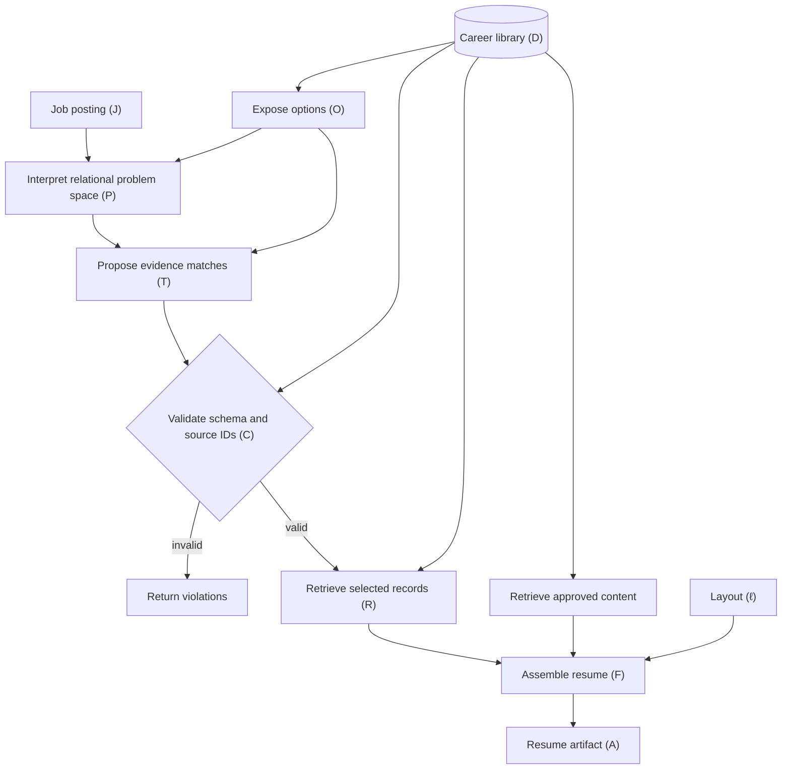

# Career Ledger — Project Kernel

**Goal:** Relate a user-supplied job posting to user-authored career evidence, propose relevant source IDs, and assemble a source-grounded resume.

## Roles and authority

- **User:** Authoritative for the job posting and stored career content.
- **Model:** Evaluates meaningful contextual/operational relationships and proposes existing evidence IDs with stated relationships.
- **Validator:** Checks JSON shape, offered/existing IDs, and source associations—not semantic relevance.
- **Executor/assembler:** Retrieves authoritative text and places it in resume sections; no model-authored career claims in v1.
- The prompt constrains the **task**, not a closed vocabulary of permitted relationships. Internal reasoning remains unobservable; only submitted inputs and output are inspectable.

## Kernel

```text
O = Options(D)
P = I_p(J, O)
T = I_s(P, O)
C(T, D, O) -> valid | invalid
R = E(T, D)           [only if valid]
A = F(R, Approved(D), ℓ)
```

- **J:** posting; **D:** live SQLite career library; **O:** offered evidence with role/project context.
- **P:** relational interpretation of J and O; conceptual, not necessarily a serialized model output.
- **I_p / I_s:** interpret the problem / propose strongest relevant matches. Distinct functions conceptually; separate model calls are **not required**.
- **T:** proposed requirement-to-evidence matches and stated relationships; **C:** structural conformance.
- **R:** database-retrieved records; **Approved(D):** preapproved non-evidence content; **ℓ:** layout; **A:** resume artifact.
- No separately managed database snapshot is required by this contract.

## Data flow

### Populate career library



### Build resume



## Contracts — initial cut

1. **Database:** [`career_schema.sql`](career_schema.sql). A parent experience record (employment/project) owns separate evidence items; changing an item's parent does not recreate its ID. Approved profile, highlight, education, certification, and toolkit content is stored separately. Only user actions edit source content.
2. **Inference:** [`inference_prompt_v1.md`](inference_prompt_v1.md) + [`selection.schema.json`](selection.schema.json). Input: `job_description: string` and `options: [{id, description, experience_id, kind, title, organization}]`. Output: `matches: [{requirement, evidence_id, relationship}]` and `unmatched_requirements: string[]`. List entries are model-stated interpretations, **not** verified career claims.
3. **Assembly:** Given validated T, fetch evidence text **and its parent metadata** from D; place it under the owning experience/project. Place only approved content in other configured sections. Preserve source wording, allow selection/order/layout, and emit a structured resume, DOCX, and source-ID mapping for career statements. Invalid selections produce no resume.

## Traceability

For each build, retain the **exact application-supplied prompt version/text, job description, offered option IDs/text/context, model/provider settings available to the app, returned proposal, validation outcome, and output-to-source mapping**. This tracks observable inference provenance, **not** hidden model reasoning or semantic correctness.
